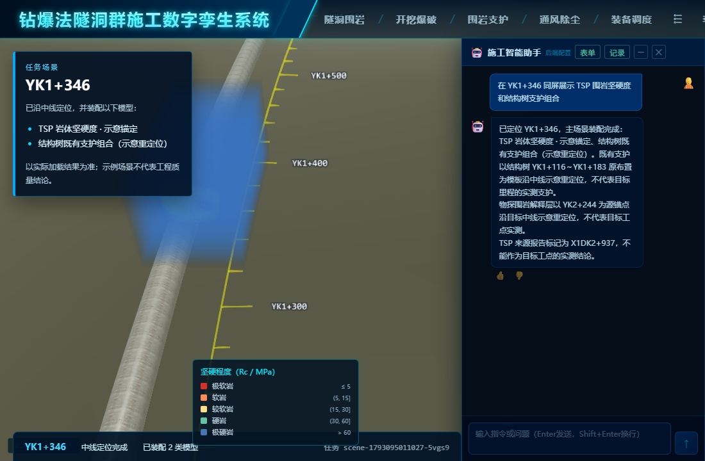

# 围岩体数据与结构树支护空间校准

本次只校准示例资产在场景中的相对摆放。TSP 坚硬度体数据源锚点为 YK2+244；结构树支护源布置为 YK1+116～YK1+183。二者均按任务目标 YK1+346 示意重定位，不是该工点的联合实测数据。

## 调整

体数据从目标里程向前展开约 100 m。此前支护组合使用 YK1+161 作为源锚点，把原布置的中部附近放到目标里程，导致大部分支护位于体数据起点之后。现将支护组合的源锚点改为 YK1+116，使其首段与目标里程对齐。单独钢架等构件仍保留原有定位语义；不改变 GLB 几何或原结构树展示。

## 真实页面量测

运行 `node scripts/diagnose-rock-support-placement.mjs`，通过 DeepSeek 发起一次 YK1+346 的 TSP 坚硬度与结构树支护组合任务。脚本在加载完成后读取体数据的 ECEF 矩阵和 1760 个支护 Cesium 模型的世界包围球，将其投影到目标 YK 中线的局部坐标系（x 横向、y 向前、z 向上，单位 m）。同时直接读取体数据 WebGL 画布，得到 56,610 个非透明可见像素，确认本次页面里体数据确实绘制出来。

| 范围 | 横向 x | 前向 y | 高度 z |
|---|---:|---:|---:|
| 体数据 | −25.0～26.9 | −0.6～100.6 | −25.0～25.5 |
| 支护组合，调整后 | −10.7～11.7 | −7.6～76.0 | −4.8～13.4 |
| 支护组合，旧锚点反算 | −10.8～10.9 | −52.6～31.0 | −5.1～13.2 |

以两者局部轴向包围范围相交长度计，前向重叠从旧锚点的 **31.6 m** 增至 **76.6 m**。支护范围使用各模型的包围球合并，因此重叠长度是保守的包围范围估计，不能作为模型网格真实相交或工程配准精度的证明。

同一脚本以 YK2+244（体数据原锚点）复验，得到相同的局部包围范围和前向重叠长度，说明这一装配语义不依赖 YK1+346 的特殊位置。

将资源切换为 `rock.tem-resistivity`，在 YK2+244 复验时，TEM 体数据的局部前向范围为 −3.9～59.6 m；支护仍为 −7.6～76.0 m。两者的前向包围范围重叠从旧锚点的 **34.9 m** 增至 **63.5 m**，画布有 82,082 个非透明可见像素。TEM 的源体数据尺寸和 TSP 不同，因此也覆盖了另一种体数据布局。

## 尚需校验

- 体数据是覆盖在 Cesium 上的独立 WebGL 画布，相机矩阵同步但深度缓冲独立；截图中的遮挡关系仍不能视为同一渲染管线的正确深度关系。
- 目前量测的是 TSP 坚硬度与 TEM 电阻率两类体数据及支护组合的演示任务。TSP 完整度、物探融合分级、单独构件及其他目标里程还需按需复验。
- 只有获得同工点数据和几何控制点，才能评价工程意义上的配准误差。当前的示意重定位只能验证平台装配流程和可视化原型。
