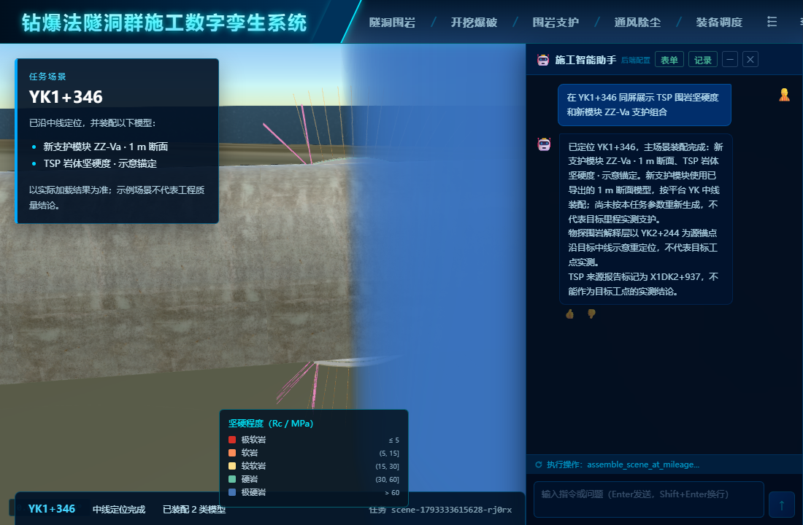

# 新支护与围岩同屏装配验证

任务：“在 YK1+346 同屏展示 TSP 围岩坚硬度和新模块 ZZ-Va 支护组合”。智能体调用 `assemble_scene_at_mileage`；平台完成 2/2 阶段。数据库快照 `scene-1793333615628-rj0rx` 读回根资源 `rock.tsp-hardness`、`support.modeler-zz-va`，以及 TSP JSON、体纹理和新支护 GLB 的内容指纹。

浏览器里体数据 WebGL 画布可见，前次像素检查得 56,610 个有效像素、WebGL 错误码 0。最后截图中支护混凝土断面与蓝色 TSP 体数据都出现在主场景。原先智能体工具在装配结束后强制返回 270 m 远景，使 1 m 支护不可辨认；现按已加载支护模型的包围范围定位镜头。构建及场景工作流测试通过。

这只验证示例资源的装配和可见性。TSP 数据源锚点为 YK2+244，重定位到 YK1+346 属于演示；支护断面也不是该里程实测。体数据为独立 WebGL 覆盖画布，与 Cesium 模型的深度遮挡关系仍有偏差，截图不能作为工程配准验收。
